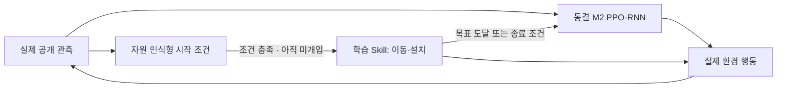

# Craftax: 동결 PPO-RNN의 자원 인식형 Skill 개입

**프로젝트 2 · 강화학습 구현·확장 포트폴리오**

Craftax-Classic에서 기존 PPO-RNN이 철 제작 재료를 확보하고도 작업대와 화로를 함께 이용할 상태에 도달하기 어려운 문제를 분석했다. 공개 관측으로 이동·설치를 수행하는 별도 Skill과 자원 인식형 시작 조건을 구현하고, 기존 정책을 동결한 상태에서 정상 게임 Return을 비교했다.

현재 자료는 **논문 제출 전 로컬 업로드 준비본**이다. 논문 게재·심사 완료 또는 새로운 PPO 알고리즘으로 표기하지 않는다. 공개 저장소 생성과 업로드는 팀의 결정에 따라 별도로 진행한다.

## 선정 논문 및 원본 저장소

- 선정 논문: [Craftax: A Lightning-Fast Benchmark for Open-Ended Reinforcement Learning](https://arxiv.org/abs/2402.16801)
- 환경 원본: [MichaelTMatthews/Craftax](https://github.com/MichaelTMatthews/Craftax)
- PPO-RNN 원본: [MichaelTMatthews/Craftax_Baselines](https://github.com/MichaelTMatthews/Craftax_Baselines)
- 사용 환경 소스: `d8499d3da008f21c8b67404aae72551c9b1d636a`
- 본 저장소의 기반과 직접 구현한 부분: [수행 내역](docs/PROJECT_WORK.md), [출처 및 관련 연구](docs/REFERENCES.md)

## 문제와 전체 동작

재료 보유만으로는 철 도구를 만들 수 없다. 필요한 재료를 유지하면서 **작업대·화로 공동 접근 상태**를 구성해야 한다. 본 프로젝트는 이 준비 단계를 보완하고 최종 제작·탐험은 기존 PPO에 맡긴다.



- PPO의 가중치를 유지하고, 개입 중에도 실제 관측으로 PPO GRU carry를 갱신한다.
- 별도 CNN-GRU Skill을 공개 Planner의 행동 시연으로 학습했다.
- 시작 판단에 제작 재료 하한과 설비 설치에 필요한 자원 여유를 반영한다.
- 에피소드당 최대 1회 호출하며, 호출 후 최대 16개의 실제 Primitive를 실행한다.
- 보상·환경 종료·M2 Mask를 고정한다. 숨겨진 전체 지도를 정책 입력에 제공하지 않는다.

[상세 구조](docs/ARCHITECTURE.md) · [전체 흐름 그림](assets/architecture.png)

## 빠른 실행

Python **3.12**, CPU 실행을 기준으로 한다. 저장소 루트에서 실행한다. 코드·동결 모델·Craftax 소스를 포함하므로 원래 연구 폴더나 별도 모델 다운로드가 필요 없다.

### Windows PowerShell

```powershell
py -3.12 -m venv .venv
.\.venv\Scripts\python.exe -m pip install -r requirements.txt -c requirements-cpu.lock
$env:JAX_PLATFORMS = "cpu"
$env:JAX_DEFAULT_MATMUL_PRECISION = "highest"
.\.venv\Scripts\python.exe verify.py --out runs/verification.json
.\.venv\Scripts\python.exe run.py --protocol phase56 --conditions B0 G0 RULE AUTO A1 C2 --seeds 138101 --world-start 56010003 --worlds 1 --rng-pairs 1 --out runs/check_world3
.\.venv\Scripts\python.exe compare.py runs/check_world3/episodes.csv --protocol phase56 --out runs/check_world3_comparison
```

### Linux / WSL

```bash
python3.12 -m venv .venv
.venv/bin/python -m pip install -r requirements.txt -c requirements-cpu.lock
export JAX_PLATFORMS=cpu
export JAX_DEFAULT_MATMUL_PRECISION=highest
.venv/bin/python verify.py --out runs/verification.json
.venv/bin/python run.py --protocol phase56 --conditions B0 G0 RULE AUTO A1 C2 --seeds 138101 --world-start 56010003 --worlds 1 --rng-pairs 1 --out runs/check_world3
.venv/bin/python compare.py runs/check_world3/episodes.csv --protocol phase56 --out runs/check_world3_comparison
```

검증 월드에서는 B0 **15.10**, G0/RULE/AUTO/A1/C2 **17.10**을 기록했다. 이는 실행 확인용으로 고른 한 월드의 결과이며 아래 전체 평균을 대체하지 않는다. 패키지 설치에는 인터넷이 필요하다. 이미 같은 Python 3.12 환경이 있다면 해당 환경의 `python`을 사용할 수 있다.

전체 평가·조건별 설명·결과 파일 정의는 [실행 안내](docs/EXECUTION_GUIDE.md)를 참고한다. 출력 경로는 비어 있어야 한다. 기본 실행은 실제 종료까지 평가하며, 짧은 `--max-steps` 실행은 중도 종료를 따로 표시한다.

## 핵심 결과

Phase 55 정상 평가: **기본 정책/Skill 8쌍 × 256월드 × 정책·환경 RNG 2쌍, 조건당 4,096게임**. 확률적 정책의 비할인 Raw Return을 사용한다.

| 조건 | 역할 | 평균 Raw Return | 기본 정책 대비 |
|---|---|---:|---:|
| B0 | 동결 M2 PPO 단독 | 14.26577 | — |
| G0 | 첫 후보에서 Skill 시작 | 14.39053 | +0.12476 |
| RULE | 자원 인식형 조건 후 Skill | **14.49502** | **+0.22925** |
| A1 | Planner로 접근·설치 | 14.55605 | +0.29028 |
| C2 | Planner로 접근·설치·첫 제작 | 14.56704 | +0.30127 |

RULE−B0의 모델별 대응 평균 차이는 **+0.22925**, 95% t 구간 **[+0.17460, +0.28389]**, 8쌍 모두 양수였다. 추가 계산을 쓰는 Planner와 Skill의 비용은 같다고 가정하지 않는다.

| 지표 | G0 | RULE |
|---|---:|---:|
| Skill 시작 | 1,753 | 1,423 |
| 준비 상태 구성 완료 | 761 | 1,168 |
| 시작 대비 완료율 | 43.41% | **82.08%** |
| 실제 Skill Primitive 합계 | 16,344 | **6,843** |

완료율의 분모는 전체 게임이 아닌 **Skill이 시작된 게임**이다. 시작 조건에 따라 집합과 시점도 달라지므로 같은 상태의 Skill 실행 능력만 비교한 지표가 아니다. RULE의 미완료 255건은 실행 한도 176건, 실행 중 사망 74건, 재료 조건 상실 5건이었다.

철곡괭이 업적은 **158→569**, 철검은 **151→653**, 다이아몬드는 **8→26/4,096**이었다. 철 제작 준비 상태 보완과 이후 탐험·생존 문제는 구분한다. RULE과 AUTO의 철 과제 동치 및 별도 월드의 AUTO 평가는 [결과 해석](docs/RESULTS.md)에 정리했다.

## 직접 수행한 작업

1. 공식 PPO-RNN과 환경을 재사용하고 M2 유효 행동 Mask를 검증했다.
2. 철 제작의 재료·설비·행동 기회를 분리해 병목을 계측했다.
3. 공개 관측 기반 선택적 Planner와 접근·설치 전용 A1을 구현했다.
4. 별도 Skill 모방학습과 기존 정책 보존형 실행기를 구현했다.
5. 자원 인식형 시작 조건, 무조건 시작·분류 head·지연 시작 등의 비교를 수행했다.
6. 동일 모델·월드·RNG 대응 평가, 행동 로그·보상 회계·GRU carry 검증을 수행했다.
7. 다른 PC에서 실행할 수 있도록 모델·의존성·고정 평가 설정과 원래 CSV 비교 도구를 정리했다.

각 작업의 코드 연결과 실패 실험은 [수행 내역](docs/PROJECT_WORK.md)에 있다. 원본 PPO-RNN, BC, Options 계열의 기존 계산을 새 알고리즘으로 재명명하지 않는다.

## 재현 범위와 현재 상태

- 즉시 실행: 동결 모델 정상 게임 평가, 원래 CSV와의 대응 비교.
- 포함 자산: PPO 8개, 철 설비 Skill 8개, 시작 분류 head, 고정 환경·모델 해시.
- 2026-11-14 기존 검증: CPU 정상 게임 **18/18**의 Return·길이·업적 대응 확인.
- 전체 학습 재현: 추론용 파라미터만 포함하며 본 저장소에서 From-scratch 학습을 자동 실행하지 않는다.
- 다른 하드웨어에서는 수치 연산 차이로 궤적이 달라질 수 있다. 동일 모델·월드·RNG와 배치 128을 유지해 비교한다.
- 논문 초안·전체 내부 연구일지·개인정보·API 키는 업로드 후보에서 제외했다.

[재현 조건](docs/REPRODUCIBILITY.md) · [한계와 반례](docs/LIMITATIONS.md) · [업로드 전 확인](docs/PUBLICATION_STATUS.md)

## 폴더 구조

```text
run.py / compare.py / verify.py  실행·원래 결과 비교·자산/전이 검증
src/                           PPO·Mask·Planner·Skill·시작 조건
models/                        평가용 동결 파라미터
vendor/                        고정 환경·공식 기반 코드와 라이선스
configs/                       Phase55/56의 실제 평가 설정
reference/                     원래 에피소드별 결과 CSV
results/                       주요 비교표 및 검산 출력
docs/                          수행 내역·구조·실행·결과·한계
validation/                    기존 소규모 재현 검증 근거
scripts/                       구조·표·링크 무결성 확인
```

제3자 라이선스는 [THIRD_PARTY_NOTICES.md](THIRD_PARTY_NOTICES.md), 자체 코드의 공개 전 상태는 [공개 범위](docs/PUBLICATION_STATUS.md)를 참고한다.
