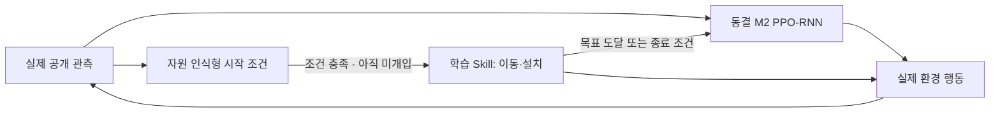

# Craftax: 동결 PPO-RNN의 자원 인식형 Skill 개입

**프로젝트 2 · 강화학습 구현·확장 포트폴리오**

본 프로젝트는 Craftax-Classic 환경에서 기존 PPO-RNN을 재현하고, 공개된 강화학습 기법을 적용한 뒤 남아 있는 정책의 한계를 분석하여 이를 보완하는 방법을 구현한 연구 프로젝트이다.

먼저 공식 PPO-RNN을 기반으로 학습·평가 환경을 구성하고, 공개된 **Invalid Action Masking(M2)** 기법을 직접 적용하였다. 초기 평가에서 기존 PPO-RNN은 평균 Raw Return 약 **11.81**, M2를 적용한 PPO-RNN은 약 **14.13**을 기록하였다.

이후 강화된 M2 PPO-RNN에서도 철 도구 제작에 필요한 자원을 확보하고도 작업대와 화로를 함께 이용할 수 있는 상태에 도달하지 못하는 문제가 관찰되었다.

이를 분석하기 위해 규칙 기반 Planner로 상태 구성 과정을 검증하고, Planner의 행동 시연을 활용해 별도의 **State-Construction Skill**을 학습하였다. 이후 목표 제작 자원과 설비 설치 비용을 고려하는 **Resource-Aware Initiation** 조건을 구현하여, 기존 PPO-RNN의 가중치를 동결한 상태에서 선택적으로 Skill이 개입하도록 구성하였다.

본 저장소는 **강화학습 논문 재현, 기존 기법 적용, 문제 분석, 제안 방법 구현 및 실험 검증** 과정을 정리한 포트폴리오이다.

현재 저장소는 논문 제출 전 **Private으로 관리**하고 있다. 논문 게재·심사 완료 또는 독립적인 신규 PPO 알고리즘을 개발한 것으로 표기하지 않는다. 향후 공개 범위와 자체 코드의 라이선스는 팀의 결정에 따라 확정한다.

## 선정 논문 및 원본 저장소

- 선정 논문: [Craftax: A Lightning-Fast Benchmark for Open-Ended Reinforcement Learning](https://arxiv.org/abs/2402.16801)
- 환경 원본: [MichaelTMatthews/Craftax](https://github.com/MichaelTMatthews/Craftax)
- PPO-RNN 원본: [MichaelTMatthews/Craftax_Baselines](https://github.com/MichaelTMatthews/Craftax_Baselines)
- 사용 환경 소스: `d8499d3da008f21c8b67404aae72551c9b1d636a`
- 본 저장소의 기반과 직접 구현한 부분: [수행 내역](docs/PROJECT_WORK.md), [출처 및 관련 연구](docs/REFERENCES.md)

## 연구 진행 과정

### 1. 기존 PPO-RNN 재현

공식 Craftax 환경과 PPO-RNN 구현을 기반으로 학습·평가 환경을 구성하고, 기존 정책의 동작과 성능을 확인하였다.

초기 평가에서 기존 PPO-RNN의 평균 Raw Return은 약 **11.81**이었다.

이 단계는 기존 강화학습 알고리즘의 재현과 동작 검증에 해당하며, PPO 자체를 새롭게 제안한 것은 아니다.

### 2. Invalid Action Masking(M2) 적용

기존 PPO-RNN에 공개된 **Invalid Action Masking(M2)** 기법을 직접 구현·적용하였다.

M2는 현재 상태에서 수행할 수 없는 행동을 Action Mask를 통해 제외하는 방식이다. 이를 통해 유효하지 않은 행동 선택을 줄이고 정책의 행동 선택을 개선하였다.

초기 평가에서 평균 Raw Return은 약 **11.81에서 14.13**으로 증가하였다.

M2는 기존 연구에서 제안된 기법으로, 본 프로젝트의 기여는 이를 Craftax PPO-RNN에 직접 적용하고 검증한 데 있다.

### 3. 상태 구성 문제 분석

M2를 적용한 이후에도 철 도구 제작과 관련한 실패가 관찰되었다.

재료를 보유하고 있더라도 실제 제작 행동을 수행하려면 작업대와 화로를 함께 이용할 수 있는 상태를 구성해야 한다.

이에 따라 철 제작 과정을 다음과 같이 구분하였다.

- **Resource Acquisition:** 필요한 제작 자원 확보
- **State Construction:** 작업대·화로 접근 및 설치를 통한 제작 가능 상태 구성
- **Action Execution:** 준비된 상태에서 실제 철 도구 제작 행동 수행

규칙 기반 Planner를 이용해 상태 구성과 최종 제작 행동을 분리하여 검증하였으며, 상태 구성 과정이 기존 정책의 주요 병목 중 하나임을 확인하였다.

### 4. State-Construction Skill 학습

규칙 기반 State-Construction Planner(A1)의 행동 시연을 수집하고, 이를 이용해 별도의 CNN-GRU 기반 Skill Policy를 Behavior Cloning으로 학습하였다.

Skill은 이동·접근·설치 등의 행동을 수행하며 목표 상태를 구성한다.

기존 PPO-RNN의 가중치는 수정하지 않고, Skill을 별도 네트워크로 학습하였다.

### 5. Resource-Aware Initiation 적용

Skill을 시작할 수 있는 상태라고 해서 항상 즉시 실행하는 것이 유리한 것은 아니다.

상태 구성을 위해 작업대나 화로를 추가 설치하면 자원이 소비되고, 그 결과 최종 제작에 필요한 자원이 부족해질 수 있다.

이를 방지하기 위해 목표 행동의 자원 요구량과 Skill 실행 과정에서 필요한 설치 비용을 함께 고려하는 시작 조건을 구현하였다.

먼저 수작업으로 지정한 자원 인식형 시작 조건(RULE)의 효과를 확인하였다. 이후 기존 Action Mask와 Skill 실행 기록을 활용해 요구 자원을 도출하는 AUTO 조건을 구현하고, 별도 평가에서 RULE과의 동작 동등성을 검증하였다.

## 제안 방법의 전체 동작

제안 방법은 **Frozen PPO-RNN + Learned State-Construction Skill + Resource-Aware Initiation**으로 구성된다.

기존 PPO-RNN이 탐험·자원 수집·전투·일반 제작을 수행하고, 특정 조건을 만족하면 별도의 Skill이 일시적으로 개입해 필요한 상태를 구성한다.

Skill 실행이 종료되면 제어권은 기존 PPO-RNN으로 돌아간다. 최종 철 도구 제작 행동도 기존 PPO가 선택한다.



주요 구현 특징은 다음과 같다.

- PPO-RNN의 학습된 가중치를 유지한다.
- Skill 개입 중에도 실제 관측을 사용해 PPO GRU Carry를 갱신한다.
- 별도 CNN-GRU Skill을 공개 관측 기반 Planner의 행동 시연으로 학습한다.
- 시작 판단에 최종 제작 자원과 설비 설치에 필요한 자원 여유를 반영한다.
- Skill은 에피소드당 최대 1회 호출하며, 호출 후 최대 16개의 Primitive Action을 수행한다.
- Skill이 종료되면 기존 PPO-RNN이 다시 행동을 선택한다.
- 보상·환경 종료·M2 Mask를 고정한다.
- 숨겨진 전체 지도를 정책 입력에 제공하지 않는다.
- AUTO는 새로운 신경망 정책이 아니라 결정적 시작 판단 규칙이다.

[상세 구조](docs/ARCHITECTURE.md) · [전체 흐름 그림](assets/architecture.png)

## 빠른 실행

Python **3.12**, CPU 실행을 기준으로 한다.

저장소 루트에서 실행하며, 코드·동결 모델·Craftax 소스를 포함하므로 원래 연구 폴더나 별도 모델 다운로드가 필요 없다.

### Windows PowerShell

```powershell
py -3.12 -m venv .venv
.\.venv\Scripts\python.exe -m pip install -r requirements.txt -c requirements-cpu.lock
$env:JAX_PLATFORMS = "cpu"
$env:JAX_DEFAULT_MATMUL_PRECISION = "highest"
.\.venv\Scripts\python.exe verify.py --out runs/verification.json
.\.venv\Scripts\python.exe run.py --protocol phase56 --conditions B0 G0 RULE AUTO A1 C2 --seeds 138101 --world-start 56010003 --worlds 1 --rng-pairs 1 --out runs/check_world3
.\.venv\Scripts\python.exe compare.py runs/check_world3/episodes.csv --protocol phase56 --out runs/check_world3_comparison
```

### Linux / WSL

```bash
python3.12 -m venv .venv
.venv/bin/python -m pip install -r requirements.txt -c requirements-cpu.lock
export JAX_PLATFORMS=cpu
export JAX_DEFAULT_MATMUL_PRECISION=highest
.venv/bin/python verify.py --out runs/verification.json
.venv/bin/python run.py --protocol phase56 --conditions B0 G0 RULE AUTO A1 C2 --seeds 138101 --world-start 56010003 --worlds 1 --rng-pairs 1 --out runs/check_world3
.venv/bin/python compare.py runs/check_world3/episodes.csv --protocol phase56 --out runs/check_world3_comparison
```

검증 월드에서는 B0 **15.10**, G0/RULE/AUTO/A1/C2 **17.10**을 기록했다.

이는 실행 확인용으로 선택한 한 월드의 결과이며, 아래 전체 평균을 대체하지 않는다.

패키지 설치에는 인터넷이 필요하다. 이미 같은 Python 3.12 환경이 있다면 해당 환경의 `python`을 사용할 수 있다.

전체 평가·조건별 설명·결과 파일 정의는 [실행 안내](docs/EXECUTION_GUIDE.md)를 참고한다.

출력 경로는 비어 있어야 한다. 기본 실행은 실제 종료까지 평가하며, 짧은 `--max-steps` 실행은 중도 종료를 따로 표시한다.

## 핵심 결과

연구 결과는 **초기 PPO-RNN 재현·M2 적용 단계**와 **이후 Skill 개입 검증 단계**로 구분한다.

### 1. 기존 PPO-RNN 재현 및 M2 적용

| 조건 | 평균 Raw Return |
|---|---:|
| 기존 PPO-RNN | 약 11.81 |
| PPO-RNN + Invalid Action Masking(M2) | 약 14.13 |

기존 PPO-RNN에 공개된 M2 기법을 직접 적용하여 기본 정책을 강화하였다.

이는 연구 초기 단계의 평가 결과다. 이후 Phase 55에서 사용한 강화된 기본 정책 및 평가 설정과는 구분해야 하므로, 두 단계의 결과를 하나의 동일 조건 실험처럼 직접 비교하지 않는다.

### 2. Phase 55 — State-Construction Skill 및 시작 조건 검증

Phase 55 정상 평가에서는 **기본 정책/Skill 8쌍 × 256월드 × 정책·환경 RNG 2쌍**, 조건당 **4,096게임**을 평가하였다.

평가 지표는 확률적 정책의 비할인 Raw Return이다.

| 조건 | 역할 | 평균 Raw Return | B0 대비 |
|---|---|---:|---:|
| B0 | 동결 M2 PPO-RNN 단독 | 14.26577 | — |
| G0 | 첫 후보에서 Skill 시작 | 14.39053 | +0.12476 |
| RULE | 자원 인식형 조건 후 Skill 시작 | **14.49502** | **+0.22925** |
| A1 | Planner로 접근·설치 | 14.55605 | +0.29028 |
| C2 | Planner로 접근·설치·첫 제작 | 14.56704 | +0.30127 |

RULE−B0의 모델별 대응 평균 차이는 **+0.22925**, 95% t 신뢰구간은 **[+0.17460, +0.28389]**였으며, 8쌍 모두 양수였다.

다만 Planner와 Learned Skill의 계산 비용이 같다고 가정하지 않으며, 위 결과가 모든 과제에서 동일한 효과를 보장하지는 않는다.

### 3. Skill 개입 효율 비교

동일한 PPO 및 Skill을 사용하고, Skill을 시작하는 조건만 변경한 G0와 RULE을 비교하였다.

| 지표 | G0 | RULE |
|---|---:|---:|
| Skill 시작 | 1,753 | 1,423 |
| 준비 상태 구성 완료 | 761 | 1,168 |
| 시작 대비 완료율 | 43.41% | **82.08%** |
| 실제 Skill Primitive 합계 | 16,344 | **6,843** |

완료율의 분모는 전체 게임이 아닌 **Skill이 시작된 게임**이다.

시작 조건에 따라 실행 대상과 시점도 달라지므로, 이 결과를 동일 상태에서의 Skill 실행 능력만 비교한 지표로 해석하지 않는다.

RULE에서 완료하지 못한 255건은 다음과 같이 분류되었다.

- 실행 한도 도달: 176건
- 실행 중 사망: 74건
- 재료 조건 상실: 5건

### 4. 주요 업적 변화

B0 대비 RULE에서 관찰된 주요 업적 횟수는 다음과 같다.

| 업적 | B0 | RULE |
|---|---:|---:|
| 철곡괭이 제작 | 158 | 569 |
| 철검 제작 | 151 | 653 |
| 다이아몬드 획득 | 8 | 26 |

각 조건은 4,096게임을 기준으로 평가하였다.

철 제작 관련 업적의 증가가 관찰되었으나, 이후 탐험·전투·생존에 관한 모든 문제가 해결된 것은 아니다.

### 5. Phase 56 — AUTO 시작 조건 검증

Phase 55의 주요 성능 수치는 수작업 자원 인식 조건인 **RULE**을 사용한 결과이다.

이후 Phase 56에서는 기존 Action Mask의 목표 자원 요구량과 Skill 실행 기록의 설치 비용을 이용해 AUTO 시작 조건을 구현하였다.

별도 평가에서 RULE과 AUTO의 **1,024개 대응 게임**에 대해 Return, 에피소드 길이, 개입 횟수 및 22개 업적 등 주요 결과가 일치함을 확인하였다.

따라서 Phase 55의 RULE 성능 수치를 AUTO를 직접 평가한 결과로 표기하지 않는다.

[결과 해석 및 상세 검증](docs/RESULTS.md)

## 직접 수행한 작업

1. **공식 PPO-RNN 재현:** Craftax 환경과 공식 PPO-RNN 구현을 기반으로 학습·평가 과정을 구성하고 기존 정책을 검증하였다.
2. **기존 기법 적용:** 공개된 Invalid Action Masking(M2)을 직접 구현·적용하고 기본 정책의 성능 변화를 확인하였다.
3. **실패 원인 분석:** 철 도구 제작 과정을 자원 확보, 상태 구성, 최종 행동 실행으로 구분하고 병목을 계측하였다.
4. **규칙 기반 Planner 구현:** 공개 관측 기반 선택적 Planner와 접근·설치 전용 A1을 구현하여 문제를 분석하였다.
5. **별도 Skill 학습:** Planner 시연을 이용해 CNN-GRU 기반 State-Construction Skill을 Behavior Cloning으로 학습하였다.
6. **기존 정책 보존형 실행:** PPO-RNN의 가중치를 동결하고, GRU Carry를 갱신하면서 Skill의 임시 개입과 PPO 복귀를 수행하는 실행기를 구현하였다.
7. **자원 인식형 시작 조건:** 목표 제작 자원 및 설치 비용을 반영한 RULE과 이를 기존 정보로부터 도출하는 AUTO를 구현·검증하였다.
8. **비교·Ablation 수행:** 무조건 시작, 분류 Head, 지연 시작 등 시작 조건 및 개입 방식에 따른 차이를 평가하였다.
9. **실험 검증:** 동일 모델·월드·RNG 대응 평가, 행동 로그·보상 회계·GRU Carry 등을 검증하였다.
10. **재현 패키지 구성:** 다른 PC에서도 실행할 수 있도록 모델·의존성·고정 평가 설정·원래 CSV 비교 도구를 정리하였다.

각 작업의 코드 연결과 실패 실험은 [수행 내역](docs/PROJECT_WORK.md)에 정리되어 있다.

본 프로젝트는 PPO-RNN, Invalid Action Masking, Behavior Cloning, Options 계열의 기존 방법을 활용하였으며, 기존 계산을 독립적인 신규 강화학습 알고리즘으로 재명명하지 않는다.

## 재현 범위와 현재 상태

- **즉시 실행:** 동결 모델을 이용한 정상 게임 평가 및 원래 CSV와의 대응 비교
- **포함 자산:** PPO 8개, 철 설비 Skill 8개, 시작 분류 Head, 고정 환경·모델 해시
- **2026-11-14 기존 검증:** CPU 정상 게임 18/18의 Return·길이·업적 대응 확인
- **2026-11-21 업로드 패키지 검증:** ZIP 무결성, 모델 역직렬화·CPU Forward, CLI·필수 자산, 원본 CSV와 결과표의 일치 여부 점검
- **전체 학습 재현:** 추론용 파라미터를 포함하며 본 저장소에서 From-scratch 학습을 자동 실행하지 않음
- **하드웨어 차이:** 다른 환경에서는 수치 연산 차이로 궤적이 달라질 수 있음
- **평가 조건:** 동일 모델·월드·RNG 및 배치 128 등 고정 평가 조건을 유지해 비교
- **비공개 자료:** 미제출 논문 초안, 전체 내부 연구일지, 개인정보 및 API 키는 업로드 후보에서 제외
- **공개 상태:** 현재 Private 저장소로 관리하며, Public 전환 여부는 별도로 결정

[재현 조건](docs/REPRODUCIBILITY.md) · [한계와 반례](docs/LIMITATIONS.md) · [공개 전 확인사항](docs/PUBLICATION_STATUS.md)

## 폴더 구조

```text
Craftax-Resource-Aware-Skill/
├── README.md
├── run.py
├── compare.py
├── verify.py
├── requirements.txt
├── requirements-cpu.lock
├── src/                 PPO·Mask·Planner·Skill·시작 조건
├── models/              평가용 동결 파라미터
├── vendor/              고정 환경·공식 기반 코드와 라이선스
├── configs/             Phase55/56 평가 설정
├── reference/           원래 에피소드별 결과 CSV
├── results/             주요 비교표 및 검산 출력
├── docs/                수행 내역·구조·실행·결과·한계
├── assets/              연구 구조도
├── validation/          기존 소규모 재현 검증 근거
└── scripts/             구조·표·링크 무결성 확인
```

## 연구 범위 및 유의사항

본 프로젝트에서 확인한 성능 개선은 지정된 Craftax-Classic 평가 조건과 철 제작 관련 상태 구성 과제를 중심으로 한다.

주요 결과는 강화된 M2 PPO-RNN을 기준으로 검증하였으며, 다른 과제·환경·학습 설정에서도 동일한 개선이 발생한다고 일반화하지 않는다.

또한 기존 PPO 파라미터를 동결하여 유지하지만, Skill의 행동 개입으로 실제 게임 궤적이 달라질 수 있으므로 기존 정책의 모든 행동 능력이 보존된다고 주장하지 않는다.

Planner를 통한 상태 구성, Behavior Cloning, 선택적 Skill 실행 등의 기존 아이디어와 본 프로젝트의 구현·검증 기여를 구분한다.

제3자 라이선스는 [THIRD_PARTY_NOTICES.md](THIRD_PARTY_NOTICES.md)를 참고하며, 자체 코드와 모델의 공개 범위 및 라이선스는 [공개 범위](docs/PUBLICATION_STATUS.md)에 정리한다.
