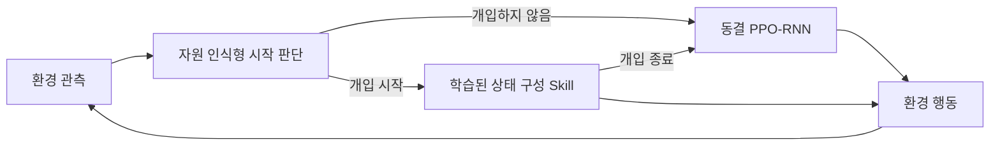

# Craftax: 동결 PPO-RNN의 자원 인식형 Skill 개입

**프로젝트 2 · 강화학습 구현 및 확장 포트폴리오**

본 프로젝트는 Craftax 환경에서 기존 PPO-RNN을 재현하고, 공개된 강화학습 기법을 적용한 뒤 남아 있는 정책의 한계를 분석하여 이를 보완하는 방법을 구현한 연구 프로젝트이다.

먼저 공식 PPO-RNN에 **Invalid Action Masking**을 적용하여 기본 정책의 성능을 개선하였다. 이후 개선된 정책에서도 철 도구 제작에 필요한 자원을 확보하고도 작업대와 화로를 함께 이용할 수 있는 상태를 구성하지 못하는 문제가 관찰되었다.

이를 보완하기 위해 규칙 기반 Planner의 행동 시연을 활용한 별도의 **State-Construction Skill**을 학습하고, 필요한 자원이 충분할 때만 Skill이 개입하도록 하는 **Resource-Aware Initiation** 방법을 구현하였다.

최종적으로 기존 PPO-RNN의 가중치를 동결한 상태에서 Skill의 선택적 개입이 정상 게임 성능에 미치는 영향을 검증하였다.

본 저장소는 기존 강화학습 알고리즘의 재현, 공개 기법의 적용, 실패 원인 분석, 방법 구현 및 실험 검증 과정을 정리한 포트폴리오이다. 논문 게재·심사 완료 또는 새로운 PPO 알고리즘의 독립적 개발을 주장하지 않는다.

## 1. 선정 논문 및 원본 저장소

- **선정 논문:** [Craftax: A Lightning-Fast Benchmark for Open-Ended Reinforcement Learning](https://arxiv.org/abs/2402.16801)
- **환경 원본:** [MichaelTMatthews/Craftax](https://github.com/MichaelTMatthews/Craftax)
- **PPO-RNN 원본:** [MichaelTMatthews/Craftax_Baselines](https://github.com/MichaelTMatthews/Craftax_Baselines)
- **사용 환경 소스:** `d8499d3da008f21c8b67404aae72551c9b1d636a`

본 프로젝트에서는 공식 Craftax 환경과 PPO-RNN 구현을 기반으로 실험을 수행하였다. 기존 소스와 직접 구현한 기능의 구분은 [수행 내역](docs/PROJECT_WORK.md) 및 [출처 및 관련 연구](docs/REFERENCES.md)에 정리하였다.

## 2. 연구 배경 및 문제 정의

### 2.1 기존 PPO-RNN 재현 및 성능 개선

Craftax는 탐험, 자원 수집, 제작, 전투 등 여러 행동을 수행하는 강화학습 벤치마크 환경이다.

먼저 공식 PPO-RNN을 기반으로 학습 및 평가 환경을 구성하고, 기존 정책의 성능을 확인하였다.

이후 공개된 **Invalid Action Masking** 기법을 직접 적용하여 현재 상태에서 수행할 수 없는 행동을 정책의 선택 대상에서 제외하였다.

초기 평가에서 확인한 평균 Raw Return은 다음과 같다.

| 모델 | 평균 Raw Return |
|---|---:|
| 기존 PPO-RNN | 약 11.81 |
| PPO-RNN + Invalid Action Masking | 약 14.13 |

Invalid Action Masking은 기존에 공개된 기법이다. 본 프로젝트에서는 이를 직접 구현하고 적용하여 이후 연구에 사용할 기본 정책을 구축하였다.

### 2.2 상태 구성 문제 발견

Invalid Action Masking을 적용한 이후에도 철 도구 제작 과정에서 실패가 관찰되었다.

철 도구 제작에는 필요한 자원을 보유하는 것뿐 아니라, **작업대와 화로를 함께 이용할 수 있는 상태를 구성하는 과정**이 필요하다.

기존 정책은 재료를 확보하고도 해당 상태에 도달하지 못하는 경우가 있었다.

이를 분석하기 위해 철 도구 제작 과정을 다음 세 단계로 구분하였다.

1. **Resource Acquisition:** 제작에 필요한 자원 확보
2. **State Construction:** 작업대·화로 접근 및 설치를 통한 제작 가능 상태 구성
3. **Action Execution:** 준비된 상태에서 실제 도구 제작 행동 수행

규칙 기반 Planner를 활용해 상태 구성과 최종 제작 과정을 분리하여 평가한 결과, 상태 구성 과정이 기존 정책의 주요 병목 중 하나임을 확인하였다.

## 3. 제안 방법

본 프로젝트에서 구현한 방법은 세 가지 요소로 구성된다.

### 3.1 Frozen PPO-RNN

기존 PPO-RNN에 Invalid Action Masking을 적용한 정책을 기본 정책으로 사용한다.

- 학습된 PPO-RNN 파라미터를 동결
- 탐험, 자원 수집, 전투 및 일반 제작 행동 수행
- GRU를 이용해 과거 관측 정보 유지
- Skill 개입 중에도 실제 환경 관측으로 PPO의 GRU 상태 갱신

Skill을 추가하기 위해 기존 PPO-RNN을 다시 학습하지 않는다.

### 3.2 Learned State-Construction Skill

규칙 기반 Planner의 행동 시연을 수집하고, Behavior Cloning을 통해 별도의 CNN-GRU 기반 Skill을 학습하였다.

학습된 Skill은 이동·접근·설치 등의 행동을 수행하여 목표 행동에 필요한 상태를 구성한다.

- 기존 PPO와 독립된 Skill 네트워크 사용
- 공개 관측을 입력으로 사용
- 여러 Primitive Action을 연속 실행
- 에피소드당 최대 1회 개입
- 호출당 최대 16개 행동 수행
- 목표 달성 또는 종료 조건 발생 시 PPO에 제어권 반환

Skill의 역할은 최종 도구 제작이 아니라 **제작 가능한 상태를 준비하는 것**이다. 최종 제작 행동은 기존 PPO가 선택한다.

### 3.3 Resource-Aware Initiation

Skill을 시작할 수 있는 상태라고 해서 즉시 실행하는 것이 항상 유리하지는 않다.

작업대와 화로를 추가로 설치하는 과정에서 자원을 소비하면, 최종 제작에 필요한 재료가 부족해질 수 있기 때문이다.

이를 방지하기 위해 다음 정보를 활용한다.

- 기존 Action Mask에서 추출한 목표 행동의 자원 요구량
- Skill 실행 기록에서 추정한 설비 설치 비용
- 현재 보유 자원과 설비 상태

목표 제작에 필요한 자원과 추가 설치 비용을 함께 고려하여 자원 예약량을 계산하고, 조건을 충족할 때만 Skill을 시작한다.

조건을 충족하지 못하면 기존 PPO가 계속 탐험 및 자원 수집을 수행한다.

처음에는 직접 지정한 자원 인식형 시작 조건으로 효과를 검증하였다. 이후 기존 Action Mask와 Skill 실행 기록에서 필요한 자원을 도출하도록 구현하고, 별도의 평가에서 두 시작 조건의 동작 일치를 확인하였다.

이 시작 판단은 새로운 신경망 정책이 아니라 **결정적 규칙**으로 구현하였다.

### 3.4 전체 실행 흐름



기본적으로 PPO가 게임을 진행하며, 시작 조건이 충족된 경우에만 Skill이 일시적으로 행동 제어권을 가져간다.

Skill이 실행되는 동안에도 PPO의 GRU 상태는 실제 관측에 따라 갱신되며, Skill 종료 후 다시 PPO가 행동을 선택한다.

[상세 구조](docs/ARCHITECTURE.md) · [전체 흐름 그림](assets/architecture.png)

## 4. 실험 결과

### 4.1 전체 게임 성능 비교

강화된 PPO-RNN을 기준으로 Skill 개입 및 자원 인식형 시작 조건의 효과를 비교하였다.

동일한 기본 정책과 평가 조건을 사용하여 **8개의 기본 정책·Skill 조합, 256개 평가 월드, 2개의 정책·환경 RNG 조건**을 평가하였다.

조건당 총 **4,096게임**을 수행했으며, 비할인 Raw Return을 평가 지표로 사용하였다.

| 평가 조건 | 평균 Raw Return | 기본 정책 대비 |
|---|---:|---:|
| 기존 PPO-RNN + Invalid Action Masking | 14.26577 | — |
| 기존 정책 + 학습된 Skill | 14.39053 | +0.12476 |
| 기존 정책 + Skill + 자원 인식형 시작 조건 | **14.49502** | **+0.22925** |
| 기존 정책 + 규칙 기반 상태 구성 Planner | 14.55605 | +0.29028 |
| 기존 정책 + 규칙 기반 전체 제작 Planner | 14.56704 | +0.30127 |

자원 인식형 시작 조건을 적용한 결과, 기본 정책 대비 평균 Raw Return이 **0.22925 증가**하였다.

8개의 대응 모델 조합에서 모두 개선이 관찰되었으며, 모델별 대응 평균 차이의 95% t 신뢰구간은 **[+0.17460, +0.28389]**였다.

규칙 기반 Planner는 별도의 계산을 수행하므로, Planner와 학습된 Skill의 실행 비용이 동일하다고 가정하지 않는다.

또한 앞서 제시한 초기 PPO-RNN 재현 결과와 이 표는 평가 단계가 다르므로, 서로 다른 결과를 하나의 직접 비교 실험처럼 해석하지 않는다.

### 4.2 자원 인식형 시작 조건의 효과

동일한 PPO와 Skill을 사용하되, Skill을 시작하는 조건을 변경해 비교하였다.

| 지표 | 즉시 개입 | 자원 인식형 개입 |
|---|---:|---:|
| Skill 시작 횟수 | 1,753 | 1,423 |
| 준비 상태 구성 완료 | 761 | 1,168 |
| 시작 대비 완료율 | 43.41% | **82.08%** |
| 실제 Skill Primitive 합계 | 16,344 | **6,843** |

자원 인식형 시작 조건을 적용한 결과, 불필요하거나 성공 가능성이 낮은 개입이 줄어들었고 Skill 시작 대비 상태 구성 완료율이 증가하였다.

다만 시작 조건에 따라 개입 대상과 시점이 달라지므로, 이 완료율을 동일 상태에서 Skill 자체의 행동 능력만 비교한 지표로 해석하지 않는다.

### 4.3 주요 업적 변화

| 업적 | 기본 정책 | 제안 방법 |
|---|---:|---:|
| 철곡괭이 제작 | 158 | 569 |
| 철검 제작 | 151 | 653 |
| 다이아몬드 획득 | 8 | 26 |

각 조건은 4,096게임을 기준으로 평가하였다.

철 도구 제작 관련 업적의 증가가 관찰되었으며, 일부 후속 업적에서도 개선이 확인되었다.

다만 상태 구성 문제를 보완했다고 해서 이후 탐험, 생존, 전투와 관련된 모든 문제가 해결된 것은 아니다.

### 4.4 자동 자원 요구량 도출 검증

자원 인식형 시작 조건의 효과를 확인한 뒤, 기존 Action Mask와 Skill 실행 기록을 이용해 필요한 자원 예약량을 도출하는 방식으로 확장하였다.

별도의 **1,024개 대응 게임 평가**에서 직접 지정한 시작 조건과 자동 도출한 시작 조건의 Return, 게임 길이, 개입 횟수 및 22개 업적 결과가 일치하였다.

앞서 제시한 주요 성능 수치는 직접 지정한 자원 인식형 시작 조건을 사용한 평가 결과이다. 자동 도출 방식의 동작 일치는 별도의 평가로 검증하였다.

[상세 결과 및 분석](docs/RESULTS.md)

## 5. 설치 및 실행 방법

Python **3.12**, CPU 실행을 기준으로 한다.

저장소에 실행 코드, 평가용 동결 모델 및 Craftax 소스를 포함하므로 원래 연구 폴더나 별도의 모델 다운로드는 필요하지 않다.

### Windows PowerShell

```powershell
py -3.12 -m venv .venv
.\.venv\Scripts\python.exe -m pip install -r requirements.txt -c requirements-cpu.lock

$env:JAX_PLATFORMS = "cpu"
$env:JAX_DEFAULT_MATMUL_PRECISION = "highest"

.\.venv\Scripts\python.exe verify.py --out runs/verification.json
```

### Linux / WSL

```bash
python3.12 -m venv .venv
.venv/bin/python -m pip install -r requirements.txt -c requirements-cpu.lock

export JAX_PLATFORMS=cpu
export JAX_DEFAULT_MATMUL_PRECISION=highest

.venv/bin/python verify.py --out runs/verification.json
```

위 명령은 설치와 기본 자산·모델 검증을 위한 것이다.

실제 게임 실행, 조건별 비교 및 전체 평가 명령어는 [실행 안내](docs/EXECUTION_GUIDE.md)에 정리하였다.

실행 안내에는 평가 설정, 모델 조합, 월드 및 RNG 지정 방법, 결과 파일 구성과 검산 절차를 포함한다.

패키지 설치에는 인터넷 연결이 필요하다.

## 6. 직접 수행한 작업

본 프로젝트에서는 공식 환경과 PPO-RNN을 기반으로 다음 작업을 수행하였다.

1. **기존 PPO-RNN 재현:** 공식 코드 기반 학습·평가 환경 구성 및 동작 검증
2. **Invalid Action Masking 적용:** 공개된 기법을 직접 구현하고 성능 변화 확인
3. **실패 원인 분석:** 철 도구 제작 과정을 자원 확보, 상태 구성 및 행동 실행으로 구분하여 병목 분석
4. **규칙 기반 Planner 구현:** 상태 구성 및 최종 제작 과정을 분리한 비교 실험 수행
5. **State-Construction Skill 학습:** Planner 행동 시연을 이용한 별도 CNN-GRU Skill 모방학습
6. **선택적 Skill 실행기 구현:** 기존 PPO의 파라미터를 동결하고 Skill 개입·종료·복귀 처리
7. **자원 인식형 시작 조건 구현:** 목표 제작 자원과 설치 비용을 고려한 시작 판단
8. **비교 및 Ablation 실험:** Skill 시작 방식과 구성 요소의 효과 비교
9. **결과 검증:** 동일 모델·월드·RNG 대응 평가, 보상 회계, 행동 로그 및 GRU 상태 검증
10. **재현 패키지 구성:** 평가 코드, 모델, 의존성, 결과 CSV 및 검산 도구 정리

본 프로젝트는 기존 PPO-RNN, Invalid Action Masking, Behavior Cloning 등의 공개된 방법을 활용하며, 기존 알고리즘을 새로운 방법으로 재명명하지 않는다.

각 작업의 코드 연결 및 구체적인 변경 사항은 [수행 내역](docs/PROJECT_WORK.md)에 정리하였다.

## 7. 재현 범위 및 한계

본 저장소는 기존에 학습한 PPO 및 Skill의 **동결된 평가용 파라미터**를 제공한다.

포함 자산은 다음과 같다.

- PPO-RNN 체크포인트 8개
- State-Construction Skill 체크포인트 8개
- 추가 시작 조건 비교에 사용한 분류 Head
- 고정 환경 소스 및 모델 정보
- 에피소드별 원본 평가 CSV
- 결과 비교 및 무결성 검증 스크립트

기존 CPU 환경에서 모델 역직렬화·Forward 및 소규모 게임 재현을 검증하였다.

다만 전체 학습 과정을 처음부터 자동 재현하는 패키지는 아니며, 다른 하드웨어에서는 수치 연산 차이에 따라 게임 궤적이 달라질 수 있다.

본 연구의 성능 개선은 지정된 Craftax-Classic 환경과 철 제작 관련 상태 구성 문제를 중심으로 검증하였다. 다른 환경이나 과제에서도 동일한 개선이 발생한다고 일반화하지 않는다.

또한 PPO의 가중치를 동결하더라도 Skill의 행동 개입으로 실제 게임 궤적은 달라질 수 있으므로, 기존 정책의 모든 행동 능력이 보존된다고 주장하지 않는다.

[재현 조건](docs/REPRODUCIBILITY.md) · [한계 및 반례](docs/LIMITATIONS.md)

## 8. 저장소 구조

```text
Craftax-Resource-Aware-Skill/
├── README.md
├── run.py
├── compare.py
├── verify.py
├── requirements.txt
├── requirements-cpu.lock
├── src/                모델·Mask·Planner·Skill·시작 조건
├── models/             평가용 동결 체크포인트
├── vendor/             공식 환경 및 기반 코드
├── configs/            평가 설정
├── reference/          에피소드별 원본 결과
├── results/            결과표 및 검산 자료
├── docs/               연구 과정·구조·실행·결과·한계
├── assets/             연구 구조도
├── validation/         재현 검증 근거
└── scripts/            구조·링크·결과 검증 도구
```

## 9. 출처 및 라이선스

Craftax 환경과 공식 PPO-RNN 구현을 기반으로 프로젝트를 수행하였다.

기존 소스 코드의 저작권 및 라이선스 고지는 보존하였다.

- [제3자 라이선스](THIRD_PARTY_NOTICES.md)
- [관련 연구 및 출처](docs/REFERENCES.md)
- [프로젝트 수행 내역](docs/PROJECT_WORK.md)
- [공개 범위 및 현재 상태](docs/PUBLICATION_STATUS.md)

자체 구현 코드와 모델의 공개 범위 및 라이선스는 팀의 결정에 따라 별도로 확정한다.
