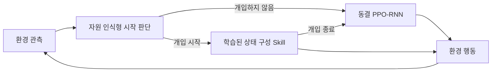

# Craftax: 동결 PPO-RNN의 자원 인식형 Skill 개입

**강화학습 구현·확장 연구 프로젝트 및 포트폴리오**

## 공동작업자 (Contributors)

**한밭대학교 · 사물인터넷 프로젝트 2 · LINKLAB (오전반 12팀)**

| 학번 | 이름 | GitHub |
|---|---|---|
| 20222018 | 김겸 | [Gyeometry](https://github.com/Gyeometry) |
| 20221987 | 문형준 | [munh36369-ship-it](https://github.com/munh36369-ship-it/munh36369-ship-it) |
| 20222049 | 채민기 | [chaemingi29-a11y](https://github.com/chaemingi29-a11y) |

---

본 프로젝트는 Craftax-Classic 환경에서 기존 PPO-RNN을 재현하고, 공개된 강화학습 기법을 적용한 뒤 남아 있는 정책의 한계를 분석하여 이를 보완하는 방법을 구현한 연구 프로젝트이다.

먼저 기존 PPO-RNN에 **Invalid Action Masking**을 적용하여 기본 정책의 성능을 개선하였다. 이후 개선된 정책에서도 철 도구 제작에 필요한 자원을 확보하고도 작업대와 화로를 함께 이용할 수 있는 상태를 구성하지 못하는 문제가 관찰되었다.

이를 해결하기 위해 규칙 기반 Planner를 이용해 실패 원인을 분석하고, 해당 Planner의 행동 시연으로 별도의 **State-Construction Skill**을 학습하였다. 또한 최종 제작에 필요한 자원과 설비 설치 비용을 고려하는 **Resource-Aware Initiation**을 구현하여, 기존 정책의 가중치를 변경하지 않고 Skill이 선택적으로 개입하도록 구성하였다.

본 저장소에는 실제 실행 코드, 학습된 모델, 평가 설정, 결과 CSV 및 재현 검증 도구를 포함한다.

> **License Notice**
>
> 본 프로젝트는 학술 연구 및 교육 목적의 재현을 위해 제공된다. 저작권자가 소유한 자체 구현 코드에는 [PolyForm Noncommercial License 1.0.0](LICENSE)이 적용되며, **상업적 이용에는 별도의 사전 허락이 필요하다.**
>
> 제3자 코드는 각 원본 라이선스를 따르며, 학습된 모델은 별도로 명시된 이용 조건을 따른다. 논문 게재 승인 후에는 자체 코드와 모델의 공개 라이선스를 확대할 예정이다.

---

## 1. 선정 논문 및 원본 저장소

본 프로젝트는 Craftax 환경과 공식 PPO-RNN 구현을 기반으로 수행되었다.

- **선정 논문:** [Craftax: A Lightning-Fast Benchmark for Open-Ended Reinforcement Learning](https://arxiv.org/abs/2402.16801)
- **환경 원본:** [MichaelTMatthews/Craftax](https://github.com/MichaelTMatthews/Craftax)
- **PPO-RNN 원본:** [MichaelTMatthews/Craftax_Baselines](https://github.com/MichaelTMatthews/Craftax_Baselines)
- **사용 환경 소스:** `d8499d3da008f21c8b67404aae72551c9b1d636a`

공식 환경 및 PPO-RNN의 원래 구현과 직접 수정·확장한 부분은 [수행 내역](docs/PROJECT_WORK.md) 및 [출처 및 관련 연구](docs/REFERENCES.md)에 구분하여 기록하였다.

## 2. 연구 배경 및 문제 정의

### 2.1 PPO-RNN 재현 및 기존 기법 적용

Craftax는 탐험, 자원 수집, 제작, 전투 등 다양한 행동을 요구하는 강화학습 벤치마크이다.

먼저 공식 PPO-RNN을 기반으로 학습·평가 환경을 구성하고 기존 정책의 동작을 검증하였다.

이후 현재 상태에서 수행할 수 없는 행동을 정책의 선택 대상에서 제외하는 공개 기법인 **Invalid Action Masking**을 직접 적용하였다.

초기 평가에서 확인한 평균 Raw Return은 다음과 같다.

| 조건 | 평균 Raw Return |
|---|---:|
| 기존 PPO-RNN | 약 11.81 |
| PPO-RNN + Invalid Action Masking | 약 14.13 |

Invalid Action Masking 자체는 기존에 공개된 기법이다. 본 프로젝트에서는 해당 방법을 실제 Craftax PPO-RNN에 구현·적용하고 검증하였다.

이 단계에서 구축한 강화된 정책을 이후 상태 구성 연구의 기본 정책으로 사용하였다.

### 2.2 상태 구성 문제 발견

행동 선택을 개선한 이후에도 철 도구 제작 과정에서 실패가 관찰되었다.

철 도구 제작을 위해서는 재료를 확보하는 것뿐 아니라 작업대와 화로를 함께 이용할 수 있는 상태에 도달해야 한다.

그러나 기존 정책은 필요한 자원을 보유하고도 해당 상태를 구성하지 못하는 경우가 있었다.

이에 따라 철 도구 제작 과정을 다음 세 단계로 구분하였다.

1. **Resource Acquisition:** 제작에 필요한 자원 확보
2. **State Construction:** 설비 접근 및 설치를 통한 제작 가능 상태 구성
3. **Action Execution:** 준비된 상태에서 실제 제작 행동 수행

규칙 기반 Planner를 이용하여 상태 구성과 최종 제작 과정을 분리해 평가한 결과, 상태 구성 과정이 기본 정책의 주요 병목 중 하나임을 확인하였다.

## 3. 제안 방법

제안 방법은 **Frozen PPO-RNN, Learned State-Construction Skill, Resource-Aware Initiation**의 세 구성 요소로 이루어진다.

### 3.1 Frozen PPO-RNN

기존 PPO-RNN에 Invalid Action Masking을 적용한 정책을 기본 정책으로 사용한다.

- PPO-RNN의 학습된 파라미터를 동결한다.
- 일반적인 탐험, 자원 수집, 전투 및 제작을 담당한다.
- GRU를 이용해 과거 관측 정보를 유지한다.
- Skill이 행동하는 동안에도 실제 환경 관측으로 PPO의 GRU 상태를 갱신한다.

Skill을 추가하기 위해 기존 PPO-RNN을 다시 학습하지 않는다.

### 3.2 Learned State-Construction Skill

규칙 기반 State-Construction Planner의 행동 시연을 수집하고, Behavior Cloning을 통해 별도의 CNN-GRU 기반 Skill Policy를 학습하였다.

Skill은 상태 구성에 필요한 이동·접근·설치 등의 행동을 수행한다.

실행 방식은 다음과 같다.

- 기존 PPO-RNN과 독립된 Skill 네트워크 사용
- 현재 공개 관측을 입력으로 사용
- 여러 Primitive Action을 연속적으로 실행
- 에피소드당 최대 1회 개입
- 한 번의 개입에서 최대 16개 행동 실행
- 목표 달성 또는 중단 조건 발생 시 PPO에 제어권 반환

Skill의 역할은 **최종 도구 제작이 아니라 제작 가능한 상태를 준비하는 것**이다.

최종 철 도구 제작 행동은 기존 PPO-RNN이 선택한다.

### 3.3 Resource-Aware Initiation

Skill을 실행할 수 있는 상태라고 해서 즉시 시작하는 것이 항상 유리하지는 않다.

작업대 또는 화로를 추가 설치하는 과정에서 자원을 소비하면 최종 제작에 필요한 재료가 부족해질 수 있기 때문이다.

이를 방지하기 위해 다음 정보를 이용한다.

- Action Mask에서 확인한 목표 행동의 필요 자원
- Skill 실행 기록에서 추정한 설비 설치 비용
- 현재 보유 자원과 설비 상태

목표 제작 자원과 추가 설치 비용을 함께 고려해 예약량을 계산하고, 필요한 자원이 확보되었을 때만 Skill을 시작한다.

조건을 충족하지 못하면 기존 PPO-RNN이 계속 행동한다.

먼저 직접 정의한 자원 인식형 시작 조건을 사용하여 효과를 검증하였다. 이후 기존 Action Mask와 Skill 실행 기록을 이용하여 자원 예약 조건을 도출하는 방식으로 확장하였다.

이 시작 판단은 별도로 학습한 신경망이 아니라 **결정적 규칙**으로 구현하였다.

### 3.4 전체 실행 구조



기본적으로 PPO-RNN이 게임을 진행하며, 시작 조건을 만족할 때만 Skill이 일시적으로 제어권을 가져간다.

Skill 실행이 종료되면 기존 PPO-RNN이 다시 행동을 선택한다.

[상세 구조](docs/ARCHITECTURE.md) · [전체 흐름 그림](assets/architecture.png)

---

## 4. 실험 결과

### 4.1 전체 게임 성능

강화된 PPO-RNN을 기준으로 Learned Skill과 자원 인식형 시작 조건의 효과를 비교하였다.

8개의 기본 정책·Skill 조합을 256개의 평가 월드와 2개의 정책·환경 RNG 조건에서 평가하여 조건당 총 **4,096게임**을 수행하였다.

평가 지표는 비할인 누적보상인 Raw Return이다.

| 평가 조건 | 평균 Raw Return | 기본 정책 대비 |
|---|---:|---:|
| PPO-RNN + Invalid Action Masking | 14.26577 | — |
| 기존 정책 + Learned Skill | 14.39053 | +0.12476 |
| 기존 정책 + Skill + 자원 인식형 시작 조건 | **14.49502** | **+0.22925** |
| 기존 정책 + 규칙 기반 상태 구성 Planner | 14.55605 | +0.29028 |
| 기존 정책 + 규칙 기반 전체 제작 Planner | 14.56704 | +0.30127 |

자원 인식형 시작 조건을 적용한 경우 기본 정책 대비 평균 Raw Return이 **0.22925 증가**하였다.

모델별 대응 평균 차이의 95% t 신뢰구간은 **[+0.17460, +0.28389]**였으며, 8개의 대응 조합 모두에서 개선이 관찰되었다.

기존 Planner와 학습된 Skill의 실행 비용이 동일하다고 가정하지 않으며, 이러한 결과를 모든 환경에서 동일하게 나타나는 일반적 성능 향상으로 해석하지 않는다.

또한 초기 PPO-RNN 재현 결과와 이 평가의 결과는 평가 단계 및 설정이 다르므로, 하나의 직접 비교 실험으로 합쳐 해석하지 않는다.

### 4.2 자원 인식형 시작 조건의 효과

동일한 PPO-RNN과 Skill을 사용하고 시작 조건만 달리하여 개입 효과를 비교하였다.

| 평가 지표 | 즉시 개입 | 자원 인식형 개입 |
|---|---:|---:|
| Skill 시작 횟수 | 1,753 | 1,423 |
| 준비 상태 구성 완료 | 761 | 1,168 |
| 시작 대비 완료율 | 43.41% | **82.08%** |
| 실제 Skill Primitive 합계 | 16,344 | **6,843** |

자원 인식형 개입 조건에서는 Skill 시작 횟수와 총 실행 행동 수가 감소하였고, 시작 대비 상태 구성 완료율이 증가하였다.

다만 시작 조건이 달라지면 개입 대상과 시점도 변경된다. 따라서 완료율 차이를 동일 상태에서 Skill 자체의 행동 능력이 개선된 결과로 단정하지 않는다.

### 4.3 주요 업적 변화

| 업적 | 기본 정책 | 제안 방법 |
|---|---:|---:|
| 철곡괭이 제작 | 158 | 569 |
| 철검 제작 | 151 | 653 |
| 다이아몬드 획득 | 8 | 26 |

각 조건은 4,096게임을 기준으로 평가하였다.

철 도구 제작 관련 업적의 증가가 관찰되었으며, 일부 후속 업적에서도 개선이 확인되었다.

다만 상태 구성 문제를 보완했다고 해서 이후 탐험, 생존 및 전투와 관련된 모든 문제가 해결된 것은 아니다.

### 4.4 자동 자원 조건 도출 검증

직접 정의한 자원 인식형 시작 조건의 효과를 확인한 뒤, 기존 Action Mask와 Skill 실행 기록을 이용하여 필요한 자원 예약량을 도출하는 방식으로 확장하였다.

별도 평가에서 **1,024개의 대응 게임**에 대해 직접 지정한 조건과 자동 도출한 조건의 Return, 게임 길이, Skill 개입 횟수 및 22개 업적 결과가 일치함을 확인하였다.

위의 주요 성능표는 직접 정의한 자원 인식형 시작 조건을 적용한 평가 결과다. 자동 도출 방식의 동작 일치는 별도 평가를 통해 검증하였다.

[상세 결과 및 분석](docs/RESULTS.md)

---

## 5. 설치 및 실행

Python **3.12**와 CPU 실행을 기준으로 한다.

저장소에는 코드, 평가용 동결 체크포인트 및 필요한 Craftax 소스가 포함되어 있어, 원래 연구 폴더나 별도 모델 다운로드 없이 평가를 진행할 수 있다.

### 5.1 Windows PowerShell

저장소 루트에서 다음 명령을 실행한다.

```powershell
py -3.12 -m venv .venv
.\.venv\Scripts\python.exe -m pip install -r requirements.txt -c requirements-cpu.lock

$env:JAX_PLATFORMS = "cpu"
$env:JAX_DEFAULT_MATMUL_PRECISION = "highest"

.\.venv\Scripts\python.exe verify.py --out runs/verification.json
```

### 5.2 Linux / WSL

```bash
python3.12 -m venv .venv
.venv/bin/python -m pip install -r requirements.txt -c requirements-cpu.lock

export JAX_PLATFORMS=cpu
export JAX_DEFAULT_MATMUL_PRECISION=highest

.venv/bin/python verify.py --out runs/verification.json
```

### 5.3 실제 게임 평가

위 명령은 설치 및 기본 자산·모델 검증을 수행한다.

실제 게임 실행, 조건별 비교, 전체 평가 및 원본 결과와의 비교는 [실행 안내](docs/EXECUTION_GUIDE.md)에 정리되어 있다.

해당 문서에는 모델 조합, 월드 및 RNG 조건, CLI 옵션, 결과 파일 구조와 검산 절차를 포함한다.

패키지 설치에는 인터넷 연결이 필요하다.

## 6. 직접 수행한 작업

본 프로젝트에서는 공식 구현을 기반으로 다음 작업을 수행하였다.

1. **PPO-RNN 재현:** 공식 환경과 PPO-RNN 기반 학습·평가 환경 구성 및 동작 검증
2. **기존 행동 마스킹 기법 적용:** Invalid Action Masking 직접 구현 및 효과 확인
3. **실패 원인 분석:** 철 제작 과정을 자원 확보, 상태 구성, 최종 행동 실행으로 구분하여 병목 분석
4. **규칙 기반 Planner 구현:** 상태 구성과 제작 행동을 분리한 비교 실험 수행
5. **별도 Skill 학습:** Planner의 행동 시연을 이용한 CNN-GRU 기반 Behavior Cloning
6. **선택적 Skill 실행기 구현:** PPO 가중치 동결, GRU 상태 연속 갱신, Skill 개입·종료·복귀 처리
7. **자원 인식형 시작 조건 구현:** 최종 제작 자원과 설치 비용을 고려한 조건 및 자동 도출 방식 검증
8. **비교 실험 수행:** 개입 방식 및 시작 조건에 따른 성능 비교와 Ablation
9. **결과 검증:** 동일 모델·월드·RNG 대응 평가, 행동 기록, 보상 및 GRU 상태 검증
10. **재현 패키지 구성:** 평가 코드, 동결 모델, 의존성, 원본 CSV 및 검산 도구 정리

기존 PPO-RNN, Invalid Action Masking, Behavior Cloning 등의 공개 방법을 활용하였으며, 기존 알고리즘을 독립적인 새로운 강화학습 알고리즘으로 주장하지 않는다.

[상세 수행 내역](docs/PROJECT_WORK.md)

## 7. 재현 범위 및 한계

본 저장소는 기존에 학습된 정책과 Skill의 평가용 동결 파라미터를 제공한다.

포함된 주요 자산은 다음과 같다.

- PPO-RNN 체크포인트 8개
- State-Construction Skill 체크포인트 8개
- 추가 비교에 사용한 시작 분류 Head 1개
- 고정 환경 소스 및 모델 정보
- 원본 에피소드별 평가 CSV
- 평가 및 검산 스크립트

기존 CPU 환경에서 체크포인트 역직렬화와 Forward 실행, 소규모 게임 평가 및 원본 결과의 대응 검증을 수행하였다.

다만 본 저장소는 모든 PPO 및 Skill을 처음부터 다시 학습하는 전체 학습 재현 패키지가 아니다.

다른 하드웨어에서는 수치 연산 차이에 따라 실제 게임 궤적이 달라질 수 있다.

본 프로젝트의 주요 개선 효과는 지정된 Craftax-Classic 환경의 철 도구 제작 관련 상태 구성 문제에서 검증되었다. 다른 환경이나 과제에서 동일한 개선이 발생한다고 일반화하지 않는다.

또한 PPO의 가중치를 동결하더라도 Skill의 행동 개입으로 게임 궤적은 달라질 수 있으므로, 기존 정책의 모든 행동 능력이 보존된다고 단정하지 않는다.

[재현 조건](docs/REPRODUCIBILITY.md) · [한계 및 반례](docs/LIMITATIONS.md)

---

## 8. 저장소 구조

```text
Craftax-Resource-Aware-Skill/
├── README.md
├── LICENSE
├── NOTICE
├── THIRD_PARTY_NOTICES.md
├── run.py
├── compare.py
├── verify.py
├── requirements.txt
├── requirements-cpu.lock
├── src/                 모델·Mask·Planner·Skill·시작 조건
├── models/              평가용 동결 체크포인트
├── vendor/              공식 환경 및 기반 코드
├── configs/             평가 설정
├── reference/           에피소드별 원본 결과
├── results/             결과표 및 검산 자료
├── docs/                연구 과정·구조·실행·결과·한계
├── assets/              연구 구조도
├── validation/          재현 검증 자료
├── LICENSES/            제3자 라이선스 전문
└── scripts/             코드·링크·결과 검증 도구
```

## 9. 라이선스 및 이용 조건

### 9.1 자체 구현 코드

**Copyright (c) 2026 Gyeom Kim**

본 프로젝트에서 저작권자가 소유한 자체 구현 코드 및 수정분에는 **PolyForm Noncommercial License 1.0.0**을 적용한다.

해당 조건에 따라 비상업적 학술 연구, 교육, 실험, 코드 수정 및 재배포를 허용한다.

**상업적 목적의 사용은 허용하지 않으며, 별도의 사전 허락이 필요하다.**

자세한 사항은 다음 문서를 따른다.

- [프로젝트 LICENSE](LICENSE)
- [라이선스 적용 범위](docs/LICENSE_SCOPE.md)

### 9.2 제3자 코드

본 프로젝트는 Craftax, Craftax_Baselines, PureJaxRL, Gymnax 등의 기존 구현을 활용한다.

해당 코드와 원본 유래 부분에는 각각의 기존 저작권 및 MIT·Apache-2.0 라이선스가 적용된다.

프로젝트 자체 코드에 대한 비상업적 이용 제한은 제3자 원본 코드의 기존 이용 허가를 변경하지 않는다.

- [제3자 라이선스 및 출처](THIRD_PARTY_NOTICES.md)
- [저작권 및 수정 고지](NOTICE)

### 9.3 학습된 모델과 실험 자산

평가용으로 제공하는 PPO-RNN, Skill 및 분류 Head 체크포인트는 실제 학습 출처를 기록하고 있다.

모델 가중치는 코드의 라이선스와 별도로 관리하며, 이용 및 재배포 조건은 [모델 라이선스](models/LICENSE.md)에 따른다.

실험 결과 CSV와 연구 그림도 자체 코드의 라이선스가 자동 적용되는 자산으로 간주하지 않는다.

### 9.4 논문 게재 이후 공개 계획

현재 프로젝트는 논문 제출 및 심사를 고려하여 자체 코드의 상업적 이용을 제한하고 있다.

관련 논문의 게재가 승인되면 자체 구현 코드와 모델의 공개 범위를 재검토하고, 권리를 보유한 자산에 대해 MIT License 등 보다 자유로운 이용 조건으로 확대할 예정이다.

단, **논문 Accept 또는 게재만으로 기존 라이선스가 자동 변경되는 것은 아니다.** 변경된 이용 조건은 별도 라이선스 파일 및 공지를 통해 적용한다.

현재의 공개 상태와 범위는 [공개 현황](docs/PUBLICATION_STATUS.md)에 정리한다.

---

## 10. 참고 및 인용

본 프로젝트의 환경과 기본 강화학습 알고리즘은 기존 공개 연구를 기반으로 한다.

기존 연구와 자체 구현 부분의 출처를 구분하며, 실제 구현과 실험 결과는 본 저장소의 평가 자료를 통해 확인할 수 있다.

연구 내용을 학술적으로 인용할 경우 원본 Craftax 논문과 해당 프로젝트의 연구 결과를 적절히 인용해 주기를 요청한다.

[관련 연구 및 참고문헌](docs/REFERENCES.md)

---

Copyright (c) 2026 Gyeom Kim.
